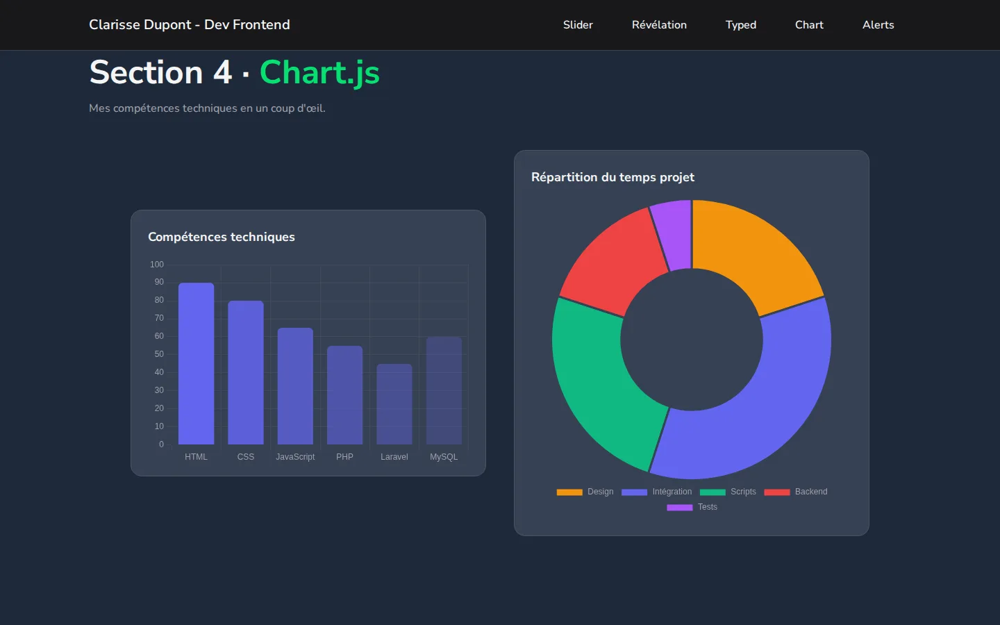

# Une page, cinq bibliothèques JS

Examen du cours **Approche front-end** (1re année de Web Design UI/UX, EAFC Fléron-Charlemagne, juin 2026).

La consigne : monter un projet avec **Vite** et **Tailwind CSS 4**, puis intégrer cinq bibliothèques JavaScript, chacune dans sa propre section. Les textes de la page sont volontairement fictifs : l'évaluation portait sur l'intégration et la qualité du code.



## Les cinq bibliothèques

| Section | Bibliothèque | Ce qu'elle fait ici |
|---|---|---|
| 1 | [Swiper](https://swiperjs.com/) | Slider plein écran en boucle, avec flèches et pagination |
| 2 | [ScrollReveal](https://scrollrevealjs.org/) | Six cartes qui arrivent de la gauche, du bas ou de la droite |
| 3 | [Typed.js](https://github.com/mattboldt/typed.js) | Une phrase qui s'écrit et s'efface toute seule |
| 4 | [Chart.js](https://www.chartjs.org/) | Un graphique en barres et un graphique en anneau |
| 5 | [SweetAlert2](https://sweetalert2.github.io/) | Trois boîtes de dialogue : succès, erreur, confirmation |

## Organisation du code

- `src/js/` : un fichier par bibliothèque, tous importés dans `main.js`
- `src/css/` : une feuille par section, écrite avec `@apply` de Tailwind
- Le code est commenté ligne par ligne

## Lancer le projet

```bash
npm install
npm run dev
```

## Portfolio

Le projet est présenté sur mon portfolio : https://clarisse-dupont.netlify.app/projets/cinq-bibliotheques-js/

---

*English: exam for the Front-end course (UI/UX Web Design, 1st year). A Vite + Tailwind CSS 4 page integrating five JavaScript libraries: Swiper, ScrollReveal, Typed.js, Chart.js and SweetAlert2.*
